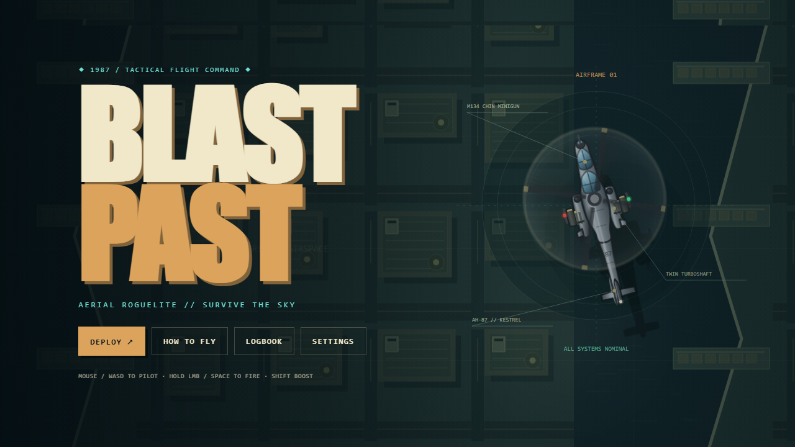
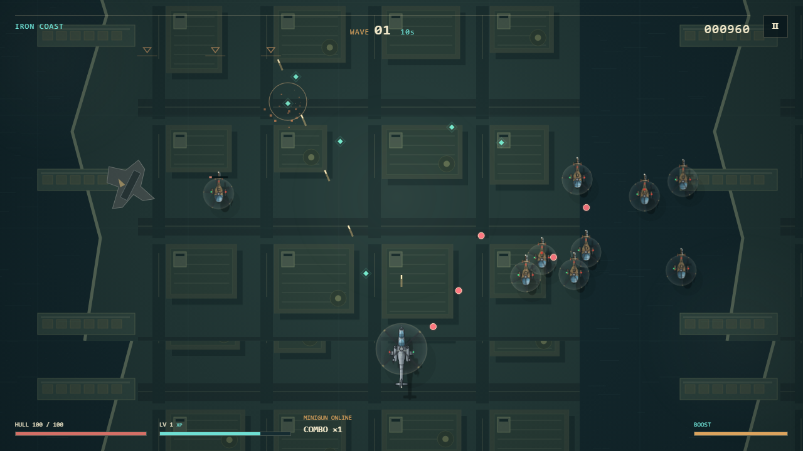

# BLAST PAST 🚁💥

BLAST PAST is a fast top-down helicopter roguelite built with vanilla JavaScript and HTML5 Canvas. Every run starts with a minigun and escalates into rockets, guided missiles, chain lightning, escort drones, explosive ammunition, and stranger combinations.

## Play

Play it in the browser at [blast-past.eyesonflash.com](https://blast-past.eyesonflash.com/). The game is hosted on Cloudflare Pages. Use a modern desktop browser.

## Controls

- **Mouse:** move the cursor to steer; hold left click or Space to fire.
- **Keyboard:** use WASD or the arrow keys to move; aim with the cursor; hold left click or Space to fire.
- The game follows whichever you used last, so there is no control setting to differ between browsers.
- **Boost:** Shift.
- **Pause:** Escape, P, or the pause button.
- **Fullscreen:** F or the settings button.
- **Upgrade selection:** click a card or press 1, 2, or 3.

The control scheme, master/SFX volume, screen shake, and particle density are available from Settings and saved locally.

## The run

- Survive authored 30-second combat waves with formations and escalating threat combinations.
- Collect physical XP salvage and select one of three weighted upgrades when leveling up.
- Fly the AH-87 Kestrel, an Apache/Viper-style tandem gunship, against a real-inspired hostile air wing: Little Bird scouts, Mi-24 Hind gunships, coaxial Ka-52 elites, tandem-rotor Chinook heavies, missile-slung Black Hawk carriers, rocket-pod Mi-17 artillery, swept-wing interceptors, delta-wing kamikaze drones, and quadcopter swarms.
- Use fuel drums, cargo containers, and projectile-blocking wreckage as part of the battlefield.
- Destroy a three-phase boss every tenth wave: a quad-rotor Assault Carrier with destructible weapon pods, or a rotating-battery Siege Platform.
- Continue through the Iron Coast, Deep Blue, and Orbital Graveyard sectors until your helicopter is destroyed.

## Builds

Five weapon families behave differently:

- **Minigun:** player-fired tracers with multishot, piercing, critical, explosive, and cryo ammunition.
- **Rocket pods:** automatic explosive salvos with blast and cluster upgrades.
- **Hunter missiles:** priority-targeting guided ordnance.
- **Arc cannon:** timed electrical chains across nearby enemies.
- **Escort drones:** orbiting autonomous weapons that can inherit minigun effects.

The 32-upgrade catalog includes weapon, airframe, system, and special choices. Prerequisites prevent unusable offers, mechanically distinct fallback upgrades support very long runs, and combinations such as explosive piercing fire, critical lightning, homing cluster ordnance, and linked drone squadrons are supported.

## Persistence

Local storage records best score, highest wave, lifetime kills, boss kills, runs, upgrade discoveries, commendations, and settings. Persistent progress is informational; each run begins on equal footing.

## Technical notes

- Vanilla ES6+, Canvas 2D, Web Audio, and localStorage — no runtime dependencies, no build step, no remote assets. `index.html` loads every module directly, so the game also runs by double-clicking it and opening it over `file://`.
- Aircraft are drawn through a shared plan-view rendering system: real rotor proportions, tail rotors on the correct side for their rotor direction, motion-blurred rotor discs that stay below the strobing limit, and a consistent world-space shadow. See [`docs/ARCHITECTURE.md`](docs/ARCHITECTURE.md) for the module map and how to add a new airframe.
- Responsive logical canvas with capped entities, particles, and audio voices.
- Fixed-step simulation with `window.advanceTime(ms)` and a concise `window.render_game_to_text()` state hook for automated testing.
- `npm test`, `npm run test:extended`, and `npm run test:golden` (a fixed-seed replay hash) all pass; `npm run test:unit` covers math/RNG and airframe realism invariants. `npm run lint` / `npm run format:check` keep the source consistent.
- `npm run package` builds a deployable `dist/blast-past/` folder and zip from the files `index.html` actually references.
- Live game is served from a Cloudflare Pages project with **no Git integration** — pushing to GitLab does not deploy it. See [`docs/ARCHITECTURE.md`](docs/ARCHITECTURE.md#deployment-manual--pushing-to-gitlab-does-not-deploy) for the manual `wrangler pages deploy` steps. Source lives under `js/`.
- `assets/` contains the repository showcase image; archived prototype notes and source are under `docs/archive/`.

`docs/archive/` keeps the rebuild checklist and the original single-file prototype.
